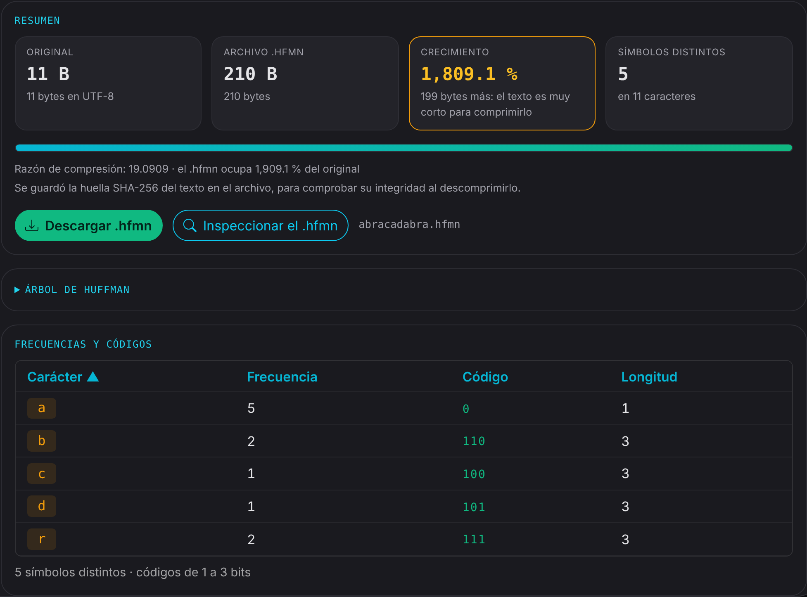
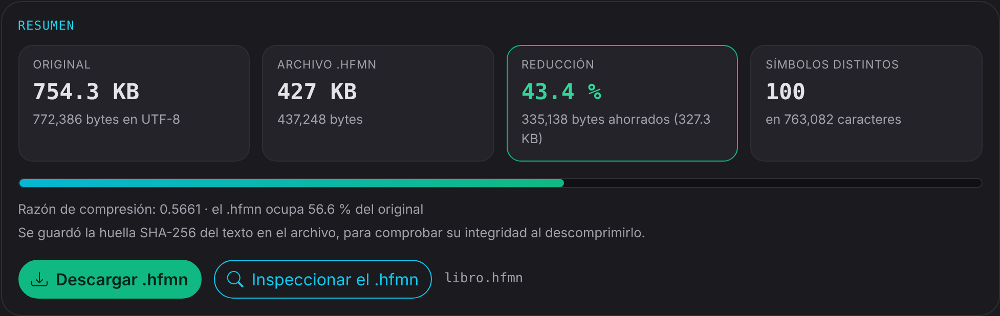
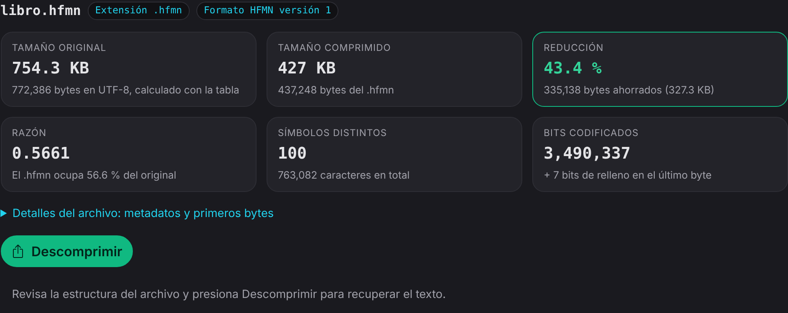
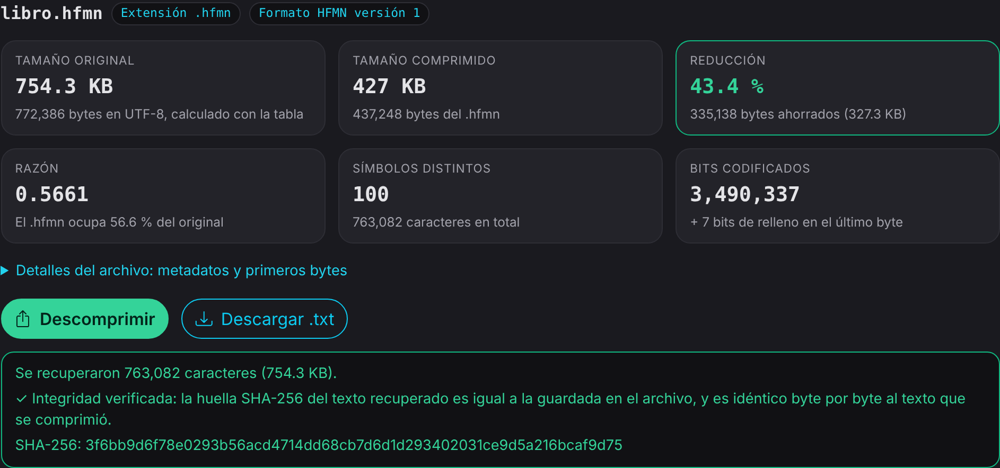
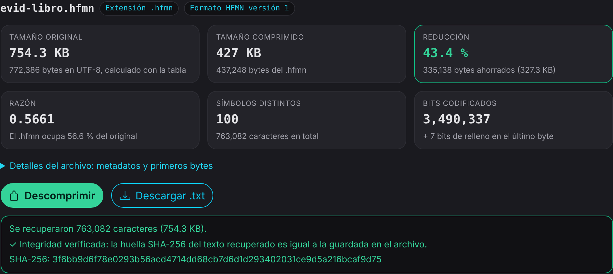
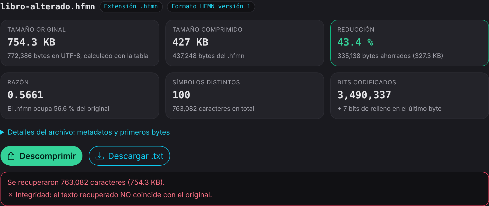
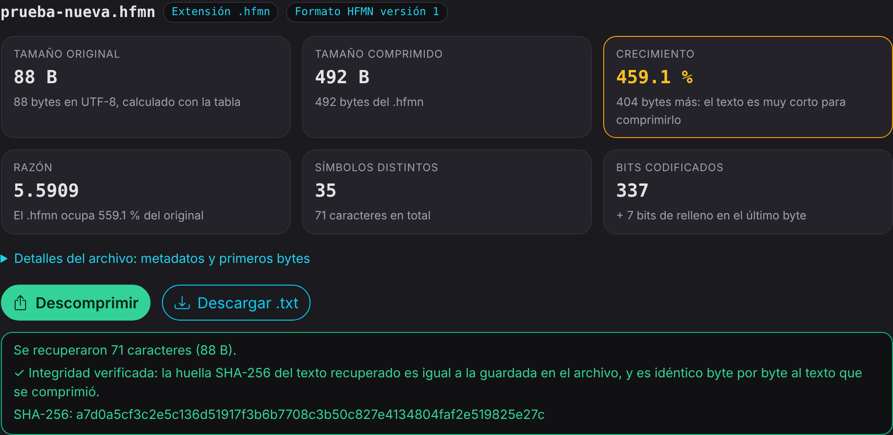

# Evidencias de las pruebas

Capturas de las cuatro pruebas mínimas de la actividad, tomadas en `huffman.html`, y la salida de las pruebas automáticas.

## Pruebas automáticas

[`pruebas-huffman.txt`](pruebas-huffman.txt): salida de `node tests/pruebas-huffman.js`. **140 aprobadas, 0 fallidas.** Cubren texto vacío, un símbolo, todos iguales, acentos, ñ, emoji, `\r\n`, archivos alterados o incompletos, `abracadabra` comparado byte por byte con el ejemplo del contrato y un libro real.

## 1. Texto pequeño

`abracadabra` (11 caracteres): las frecuencias a = 5, b = 2, r = 2, c = 1, d = 1 dan los códigos a = `0`, b = `110`, r = `111`, c = `100`, d = `101`, que se pueden comprobar a mano con el árbol. El `.hfmn` es más grande que el texto porque la cabecera, los metadatos y la tabla pesan más que lo que se ahorra.

## 2. Libro de Project Gutenberg

*Pride and Prejudice* (Gutenberg): 772,386 → 437,248 bytes, 43.4 % de reducción, 100 símbolos distintos.

## 3. Integridad

**Antes de descomprimir:** el inspector muestra la estructura del `.hfmn` sin el texto.

**Después de descomprimir:** la huella SHA-256 del texto recuperado coincide con la guardada en el archivo, y el texto es idéntico byte por byte al que se comprimió.

**El `.hfmn` descargado, cargado de nuevo sin el original:** la huella coincide.

**Un `.hfmn` con un solo byte de datos alterado:** el inspector detecta que el texto recuperado no coincide.

## 4. Archivo no usado durante el desarrollo

Un `.txt` nuevo con ñ, acentos, `¿`, `¡`, emoji y saltos de línea `\r\n`: se comprime, se inspecciona y se recupera con integridad verificada.

